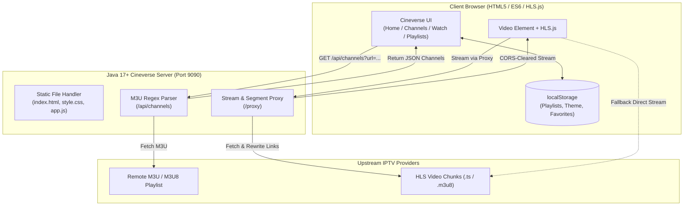

# 🎬 CINEVERSE &middot; Live TV, Your Universe

<p align="center">
  
  
  
  
  
</p>

<p align="center">
  <b>A lightweight, high-performance IPTV web platform with a zero-dependency Java backend and a modern brutalist frontend.</b><br>
  Paste any M3U / M3U8 playlist, organize multiple playlists, filter categories, search channels, and stream live TV seamlessly with built-in CORS proxying.
</p>

---

## 📑 Table of Contents
- [✨ Key Features](#-key-features)
- [🏗️ System Architecture](#️-system-architecture)
- [📁 Project Structure](#-project-structure)
- [🚀 Quick Start Guide](#-quick-start-guide)
- [⌨️ Keyboard Shortcuts](#️-keyboard-shortcuts)
- [📡 API Documentation](#-api-documentation)
- [🎨 Design System](#-design-system)
- [🛡️ CORS & Stream Resilience](#️-cors--stream-resilience)
- [📜 License](#-license)

---

## ✨ Key Features

- **⚡ Zero-Dependency Java Backend**:
  - Built entirely using native Java 17+ libraries (`com.sun.net.httpserver`, `java.net.http.HttpClient`, `java.util.regex`).
  - No Maven, Gradle, Spring, or third-party JARs required. Runs with a single command.
- **📺 Resilient Live Player**:
  - Powered by **hls.js** with automatic proxy-to-direct fallback.
  - Fixes CORS blocks, non-standard m3u8 headers, and stream token truncations.
  - Browser autoplay policy handler (automatically mutes and prompts if blocked by browser policy).
- **📂 Browser-Stored Playlists Manager (`localStorage`)**:
  - Save multiple M3U / M3U8 playlists with custom friendly names.
  - Switch between playlists in 1 click from either the Home quick-bar or the dedicated **Playlists** manager.
  - Preloaded with verified country & category presets (*India, USA, UK, News, Sports, Music, Movies*).
- **🔀 Channel Flipping**:
  - Switch channels instantly using the **Prev** and **Next** buttons or keyboard arrow keys without returning to the grid.
- **📱 100% Responsive Design**:
  - App-style mobile navigation bar with swipeable tabs.
  - 2-column mobile channel grid and auto-scaling cinematic player.
- **🌓 Red Vivid Dark / Light Theme Toggle**:
  - Inspired by the **Red Vivid** design system (`Varela Round` typography, `radius: 0px` brutalist geometry, vivid red accents).
  - Theme preference persists across sessions via `localStorage`.
- **🔇 Background Playback Prevention**:
  - Automatically pauses video, frees network buffers, and destroys HLS instances when you navigate away from the player.

---

## 🏗️ System Architecture



---

## 📁 Project Structure

```text
iptv/
├── api/                     # Vercel Serverless Functions
│   ├── channels.js          # /api/channels M3U fetcher & JSON parser
│   └── proxy.js             # /proxy stream relay & .m3u8 rewrite
├── vercel.json              # Vercel deployment rewrites & routing configuration
├── package.json             # ES module definitions for Vercel
├── CineverseServer.java     # Pure Java 17+ HTTP server, M3U parser & CORS proxy
├── CineverseServer.class    # Compiled Java bytecode
├── README.md                # Project documentation
└── web/
    ├── index.html           # Single-Page Application (SPA) structure
    ├── style.css            # Red Vivid design system & mobile-responsive CSS
    └── app.js               # Frontend player engine, storage, & UI logic
```

---

## 🚀 Deployment & Running

### Option A: Deploy to Vercel (1-Click & Cloud Ready) ⚡

Cineverse comes pre-configured with Vercel Serverless Functions (`api/channels.js` and `api/proxy.js`) and `vercel.json`.

1. **Push to GitHub**:
   ```bash
   git add .
   git commit -m "feat: add Vercel serverless functions"
   git push origin main
   ```
2. **Import into Vercel**:
   - Go to [vercel.com/new](https://vercel.com/new).
   - Select your `cineverse-iptv` GitHub repository.
   - Leave all default settings (Framework Preset: **Other**, Root Directory: `./`).
   - Click **Deploy**.
3. Your IPTV platform is live instantly with global CDN acceleration and CORS-enabled serverless proxying!

---

### Option B: Run Locally with Pure Java (Port 9090) ☕

#### Prerequisites
- **Java Development Kit (JDK) 17** or higher installed (`java -version`).

1. Compile the standalone server:
   ```bash
   javac CineverseServer.java
   ```
2. Start Cineverse:
   ```bash
   java CineverseServer
   ```
3. Open **[http://localhost:9090](http://localhost:9090)** in your browser.

---

## ⌨️ Keyboard Shortcuts

When on the **Watch** screen, navigate channels like a TV remote:

| Key | Action |
| :---: | :--- |
| `←` (Left Arrow) | Flip to **Previous Channel** |
| `→` (Right Arrow) | Flip to **Next Channel** |
| `F` | Toggle **Fullscreen Mode** |
| `Space` | Play / Pause Stream |

---

## 📡 API Documentation

### 1. Get Channels JSON
Downloads, parses, and converts any M3U playlist into structured JSON.
* **Endpoint**: `GET /api/channels`
* **Query Parameter**: `url=<encoded_m3u_url>`
* **Response**:
```json
[
  {
    "name": "CNN International",
    "url": "https://stream.provider.com/live/cnn.m3u8",
    "logo": "https://i.imgur.com/logo.png",
    "group": "News"
  }
]
```

### 2. CORS Stream Relay
Proxies HLS streams and rewrites nested playlist references so all `.ts` segments pass through the proxy with open CORS headers (`Access-Control-Allow-Origin: *`).
* **Endpoint**: `GET /proxy`
* **Query Parameter**: `url=<encoded_stream_url>`

---

## 🎨 Design System

Cineverse utilizes the **Red Vivid** aesthetic:

| Token | Dark Mode (Default) | Light Mode |
| :--- | :--- | :--- |
| **Primary** | `#d10202` (Vivid Crimson) | `#d10202` |
| **Accent** | `#db8a1f` (Warm Amber) | `#d97706` |
| **Destructive** | `#ff3333` (Coral Red) | `#ff3333` |
| **Background** | `#000000` (Pure Black) | `#ffffff` |
| **Card / Surface** | `#0a0a0c` | `#f8f8fa` |
| **Borders** | `#222226` | `#e2e2e8` |
| **Corner Radius** | `0px` (Brutalist) | `0px` |
| **Typography** | `Varela Round`, sans-serif | `Varela Round`, sans-serif |

---

## 🛡️ CORS & Stream Resilience

IPTV links often suffer from expired tokens, strict referrer checks, and missing CORS headers. Cineverse handles this transparently:
1. **Dynamic URL Query Parsing**: Stream URLs containing nested query tokens (`&token=...`, `&auth=...`) are preserved without truncation.
2. **Preflight `OPTIONS` Support**: Fully responds to preflight requests so browser security checks pass.
3. **Format Fallback**: Non-HLS direct streams (`.mp4`, `.webm`) gracefully fallback to native HTML5 video tags if HLS manifest parsing fails.
4. **Dual-Mode Fallback**: If an upstream CDN blocks local proxy IPs, the client automatically retries direct connections.

---

## 📜 License

This project is licensed under the **MIT License** &mdash; see the LICENSE file for details. Built for educational and PBL demonstration purposes.
